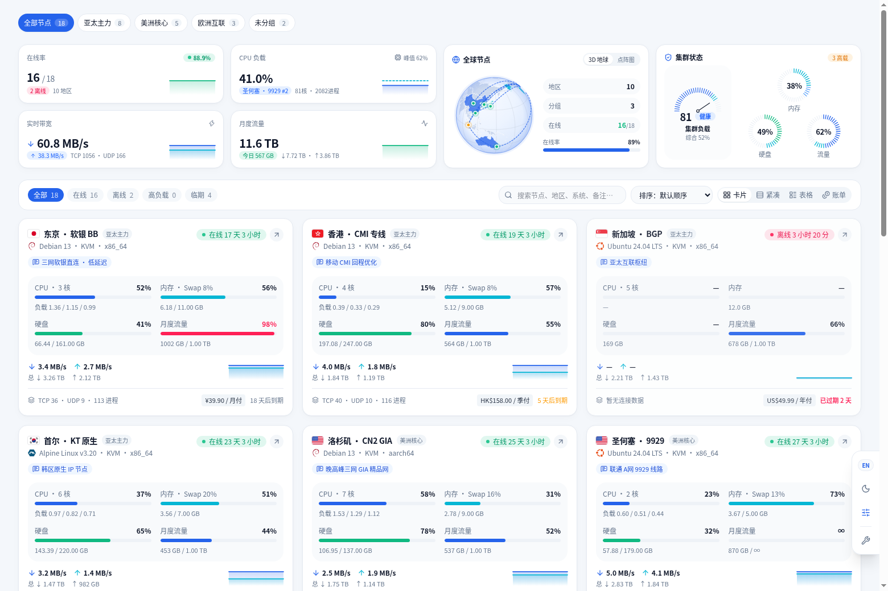

# Vibe (`monitor-theme-vibe`)

[](https://github.com/jeannnz/monitor-theme-vibe/actions/workflows/ci.yml)

**Vibe** — 高密度多维度趋势矩阵探针监控主题，专为 [极简探针 (Monitor)](https://github.com/monitor-probe/monitor) 打造。



---

## 安装使用

在极简探针后台 **「主题」** 页面，粘贴仓库地址并点击 **「从 GitHub 安装」**：

```text
https://github.com/jeannnz/monitor-theme-vibe
```

也可从 [Releases](https://github.com/jeannnz/monitor-theme-vibe/releases) 下载 `theme.tar.gz`，解压至探针服务端的 `<themes-dir>/vibe/` 目录并在后台启用。

---

## 主题配置项 (`theme.json`)

| 字段 Key | 类型 | 默认值 | 说明 |
| :--- | :--- | :--- | :--- |
| `language` | `select` | `"zh"` | 默认语言：`zh`（简体中文）/ `en`（English）/ `auto`（跟随浏览器） |
| `subtitle` | `string` | `""` | 页脚品牌副标题（留空隐藏） |
| `notice` | `text` | `""` | 顶部公告栏文案（留空隐藏） |
| `accent_color` | `select` | `"blue"` | 主题主色：`blue` / `cyan` / `teal` / `indigo` |
| `default_theme` | `select` | `"system"` | 默认外观模式：`system` / `light` / `dark` |
| `default_view` | `select` | `"grid"` | 默认节点视图：`grid` / `compact` / `table` |
| `columns` | `number` | `3` | 桌面端网格列数：`2`–`4` |
| `show_kpi` | `boolean` | `true` | 是否显示左半屏四宫格趋势矩阵 |
| `show_analytics` | `boolean` | `true` | 是否显示右半屏全球节点与集群状态 |
| `map_style` | `select` | `"globe"` | 全球节点默认视图：`globe`（3D 地球）/ `dotted`（点阵图） |
| `show_sparkline` | `boolean` | `true` | 节点卡片内是否显示实时网速折线 |
| `show_billing` | `boolean` | `true` | 是否显示资费、到期倒计时与账单视图 |
| `footer_text` | `string` | `""` | 页脚附加文案 |

---

## 本地开发与构建

```bash
# 1. 安装依赖
npm install

# 2. 启动内置模拟 Hub 服务（监听 127.0.0.1:9911）
node scripts/mock-hub.mjs

# 3. 启动 Vite 开发服务器（自动代理 /api 到 127.0.0.1:9911）
npm run dev

# 4. 代码检查与单元测试
npm run lint
npm test

# 5. 构建生产产物并打包主题归档
npm run build
tar czf theme.tar.gz dist theme.json preview.png
gzip -t theme.tar.gz
```

## 许可证

[MIT](./LICENSE)
